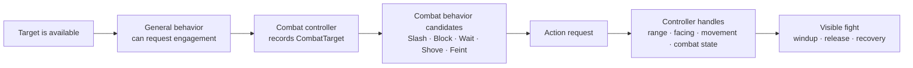

# Melee bot combat — TL;DR

> [!summary]
> A melee bot has configured behavior choices such as Slash, Block, Wait, Feint, and Shove. Those
> choices can request combat work, while the combat controller owns the immediate fight: target,
> spacing, movement, facing, attacks, and defensive state.

## The fight in one picture



| Layer | Short version |
|---|---|
| **Target** | Normal melee combat needs a valid controller-side combat target. |
| **Behavior set** | A behavior set is an inventory of possible choices, not a fixed combo script. |
| **Scoring** | Weight, distance, cooldowns, nearby allies, randomness, and other considerations shape which candidate is attractive. |
| **Action** | A selected behavior can request attack, block, wait, dodge, or a movement intent. |
| **Combat controller** | The controller produces the visible approach, range control, facing, attack state, and defense. |

## What a normal melee bot is configured to do

| Attack pressure | Defense | Movement and position | Event-associated options |
|---|---|---|---|
| Slash, Overhead, Stab, Feint, Shove | Block, Dodge, Riposte | Approach target, hold a range, face target, lateral combat motion | Responses to incoming attack, shove, parry success, damage, and guard-break opportunities |

The normal combat inventory is `BS_Combat_Melee_Normal_C`. Its main behavior candidates are:

```text
BC_Slash_C
BC_OverheadStab_C
BC_FeintAttack_C
BC_Block_C
BC_Wait_C
BC_Shove_C
```

The [asset and function atlas](asset-atlas.md) explains these names and the related actions,
inputs, target generators, event sets, and controller functions.

## Three rules that prevent wrong conclusions

> [!tip] A behavior set is an inventory
> Seeing `BC_Slash_C` or `BC_Block_C` on a bot shows that it is available to consider. It does not
> prescribe a fixed order such as “slash, then block, then shove.”

> [!warning] Cached is not selected
> A bot can hold cached behavior objects without evidence that its decision layer selected one of
> them. Visible combat is also not proof that a particular behavior caused it.

> [!info] Native combat movement is its own layer
> The combat controller can pursue, face, move around, and fight a target once combat is active.
> That movement layer is separate from proving a specific UtilityAI winner.

## What is safe to rely on

| Established in controlled use | Not a reliable public control |
|---|---|
| Set a valid combat target through the supported engagement surface. | Deterministic clockwise or counter-clockwise native circling. |
| Use controller-side close-range spacing controls. | Public control of native lateral-motion strength, phase, or direction. |
| Use waypoint/path-following for repeatable scripted routes. | Treating a behavior-set write as an automatic rebuild of existing behavior objects. |
| Read or tune an exact live behavior instance for controlled research. | Assuming a weight change guarantees a visible winner. |

## Where to go next

| Question | Page |
|---|---|
| Why might a bot prefer Block instead of Slash? | [Decision-making and scoring](decision-making.md) |
| What do the score curves mean? | [Behavior and movement formulas](formulas.md) and [Curve explorer](curve-explorer.md) |
| How do the bot’s named assets and functions fit together? | [Asset and function atlas](asset-atlas.md) |
| Why does it approach, face, or orbit a target? | [Movement and spacing](movement-and-spacing.md) |
| Which conclusions are verified and which are still open? | [Evidence and limitations](evidence-and-limitations.md) |
