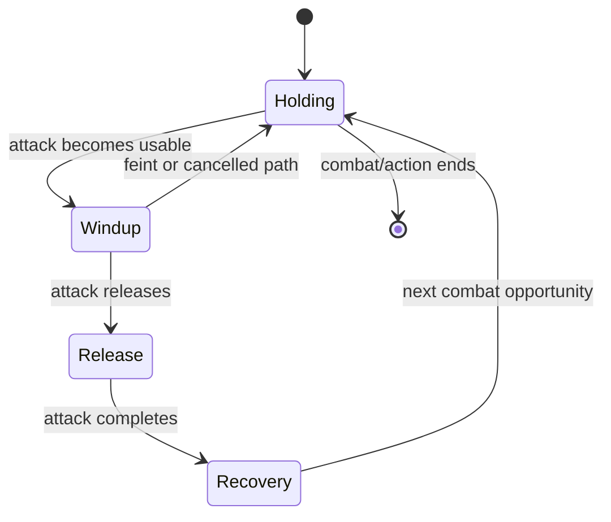
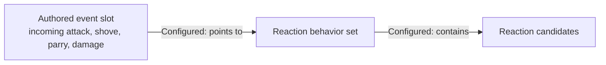

# Combat actions and reactions

Combat behaviors describe the bot’s available close-fight options. They do not directly describe a
fixed combo. Each behavior can become more or less attractive based on its considerations, then an
action requests an attack, defense, movement intent, or short delay from the combat controller.

## Normal melee combat options

| Behavior | Player-facing intent | Action request | Evidence boundary |
|---|---|---|---|
| Slash | Make a standard horizontal attack. | Request Slash and attack-oriented spacing. | **Configured:** allowed attack and action wiring. |
| Overhead/Stab | Use a higher-weight attack option that can choose overhead or stab. | Request Overhead or Stab. | **Configured:** allowed attacks and considerations. |
| Feint attack | Begin an attack and potentially turn it into a feint. | Request an attack; on the appropriate windup path, request a feint. | **Configured:** action sequence. Exact live frequency is unknown. |
| Block | Defend for a short time. | Request and hold parry, then release it. | **Configured:** action and hold duration. |
| Wait | Avoid committing to an immediate attack. | Keep a spacing intent and finish after a short wait. | **Configured:** fallback behavior and wait range. |
| Shove | Use a close pressure or response option. | Request Shove. | **Configured:** allowed attack and recent-block/cooldown concerns. |

The normal combat set contains these as available candidates. A live combat state showing Slash or
Parry is not, by itself, proof that the corresponding behavior won a decision.

## Attack actions

An attack action provides the controller with an allowed attack list and an attack-oriented spacing
request. The controller then checks the current combat situation and carries out a usable attack
when its combat gate and weapon/range conditions allow it.

### Player-facing combat-state lifecycle

Plaintext: an attack request can pass through holding, windup, release, and recovery. A feint or
cancelled path can return to holding; action completion or leaving combat ends the current path.
These are player-facing combat states, not a proof of which behavior candidate won.

For an ordinary attack behavior, the player-visible lifecycle is typically:

1. the action requests an allowed attack;
2. the controller pursues range and attack state;
3. the pawn enters combat states such as holding, windup, release, and recovery;
4. the action watches relevant state changes to decide when it can finish.

This is why an attack request is not identical to an instant swing. It is a request that passes
through controller movement, weapon availability, combat state, and action completion rules.

### Feints

The feint behavior is configured to begin from an attack list and, during the relevant attack
window, choose a different follow-up from a feint list. It expresses the feint through a second
controller attack request rather than through a separate player-input recipe.

**Configured:** the behavior can request a feint.  
**Unknown:** its exact live selection frequency and timing distribution in an ordinary match.

## Block and defensive actions

The normal Block behavior requests the controller hold parry at a reaction-oriented priority, waits
for its configured hold time, then revokes the request.

This is important because defensive behavior is more than a visual animation:

- the controller tracks who requested the defensive input;
- a hold can persist while the action is active;
- releasing the action removes that request;
- competing actions can still be governed by action-completion and interruption rules.

The configured normal melee Block behavior is a short proactive defensive option. Event-associated
defense behaviors can use more urgent settings when a specific incoming-combat event is available.

## Event-associated reaction options

The combat decision-maker configuration has slots for event-associated behavior sets. These are
best read as reaction **inventories**: they define options that may be considered when the
corresponding event is handled.

Plaintext: an authored combat-event slot points to a reaction set containing candidate behaviors.
The diagram does not connect a live event to evaluation or a visible response: event dispatch,
selection, and execution in an ordinary fight remain **Unknown**.

| Event category | Documented configured options | What it means |
|---|---|---|
| Incoming attack | Block incoming attack, dodge back, wait; some variants include Jab. | The bot has defensive and counter-pressure candidates for an attack threat. |
| Incoming shove | Attack through shove, block incoming shove, dodge back from shove. | The bot has authored shove-response candidates. |
| Parry success | Riposte, counter with shove, riposte with feint. | The bot has authored post-parry pressure options. |
| Damage caused | Slash, overhead/stab, wait. | The bot can continue ordinary attack or wait behavior after causing damage. |
| Enemy guard-break or CC | Wait and guard-break punishment. | The bot has a configured punish opportunity. |
| Several other slots | No authored normal-melee set is established. | Do not infer a special reaction merely from the slot name. |

!!! warning "Configured reaction is not observed reaction"
    The listed behaviors establish what an event set contains. They do not establish that a live
    event dispatched the set, that the decision layer was active, or that any listed behavior won.

??? info "Variant sets"
    Some documented variants simplify the response inventory. For example, a simpler incoming-attack
    variant can omit Jab, and a simpler parry-success variant can omit the feint option. These
    differences describe authored capability, not a measured difficulty curve or event frequency.

## Riposte, dodge, and punish behaviors

These event-associated actions are more specialized than the normal six-behavior combat set:

- **Riposte** is an authored post-parry attack option.
- **Dodge back** is a defensive movement response with configured conditions that include a specific
  incoming-attack context and a close distance band.
- **Counter with shove** is an urgent shove option after a parry-related opportunity.
- **Guard-break punishment** is an urgent attack option configured for very close pressure.

They show that the bot has distinct authored responses for some combat opportunities. They do not
yet give us a complete observed map from every player action to every bot response.

## What this controls, does not control, and leaves unknown

| Category | Summary |
|---|---|
| **Controls** | Authored actions can request attacks, feints, parry holds, waiting, dodges, and event-associated pressure or defense. |
| **Does not control by itself** | An allowed attack list or configured event set does not guarantee an immediate move, swing, block, or reaction. |
| **Unknown** | A complete live event-to-winner-to-visible-response trace for ordinary melee bots. |

See [Movement and spacing](movement-and-spacing.md) for the controller layer that can carry attack
and defensive requests into position, facing, and combat state when the engagement gate is active.
