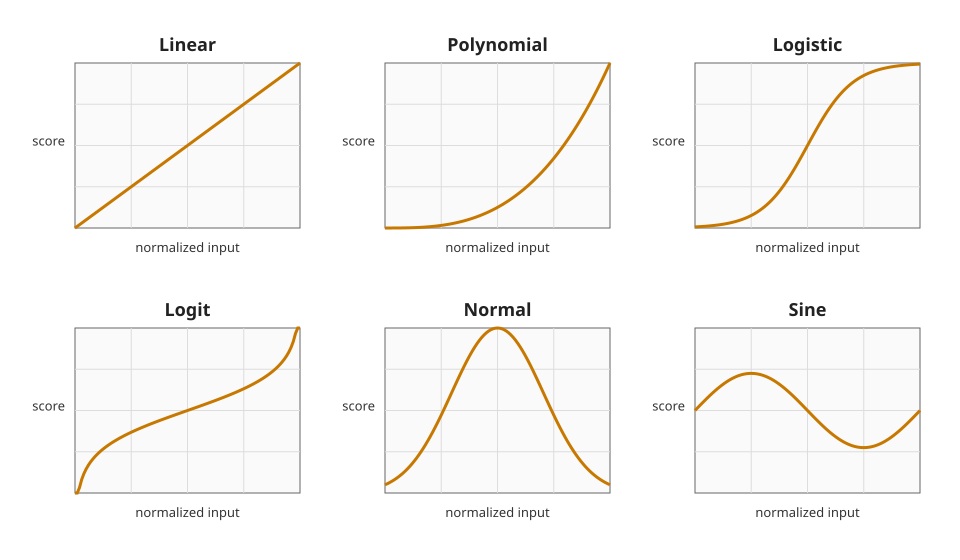

# Curve explorer

Considerations turn a normalized world value into a score from 0 to 1. The curve does **not**
predict a complete behavior winner. It shows how one input helps or hurts one candidate before other
considerations, active actions, and decision rules are applied.

## Curve families at a glance

| Curve type | Good mental model |
|---|---|
| Linear | A steady ramp up or down. |
| Polynomial | A ramp that can react early or only near an extreme. |
| Logistic | A soft threshold. |
| Logit | A very sharp central transition. |
| Normal | Prefer a middle band. |
| Sine | Repeat a rise and fall. |

The exact equations are in [behavior and movement formulas](formulas.md).

## Explore documented normal-melee considerations

Select an example and move the normalized-input slider. The graph and numbers use the documented
range and curve parameters for that consideration.

  <label for="curve-example">Consideration</label>
  <select id="curve-example" data-curve-example></select>

  

  <svg data-curve-plot viewBox="0 0 720 360" role="img" aria-labelledby="curve-plot-title curve-plot-description">
    <title id="curve-plot-title">Consideration curve</title>
    <desc id="curve-plot-description">A graph of normalized input on the horizontal axis and curve score on the vertical axis.</desc>
  </svg>

  <label for="curve-input">Normalized input: <output data-curve-normalized>0.00</output></label>
  <input id="curve-input" data-curve-input type="range" min="0" max="1" step="0.01" value="0">

  <table>
    <tbody>
      <tr><th scope="row">Raw input</th><td data-curve-raw></td></tr>
      <tr><th scope="row">Range</th><td data-curve-range></td></tr>
      <tr><th scope="row">Parameters</th><td data-curve-parameters></td></tr>
      <tr><th scope="row">Curve score</th><td data-curve-score></td></tr>
    </tbody>
  </table>

  
<strong>Interpretation:</strong> 

!!! warning "This is one consideration, not the final decision"
    The displayed value is one curve output. A behavior can have several considerations, and those
    are combined with its base weight and runtime decision/action rules. The explorer therefore
    must not be read as an attack probability.

## Non-interactive examples

| Consideration | Range | Curve | What it illustrates |
|---|---:|---|---|
| Slash cooldown | 0–5 seconds | Polynomial: \(M=1, K=3, C=0, B=0\) | The score rises slowly at first and more sharply as time passes. |
| Block distance | 0–375 units | Polynomial: \(M=-1, K=10, C=0, B=1\) | Close targets preserve a high score; distant targets are penalized sharply. |
| Block repeat timing | 0–6 seconds | Linear: \(M=10, K=1, C=0.85, B=0\) | A threshold-like delay before the behavior becomes attractive. |
| Wait fallback | 0–1 | Linear: \(M=0, K=1, C=0, B=0.25\) | A stable low fallback score. |
| Shove recent blocks | 0–4 | Polynomial: \(M=1, K=2, C=0, B=0\) | Recent blocking pressure makes Shove more attractive. |
| Overhead/Stab cooldown | 0–1 seconds | Polynomial: \(M=1, K=3, C=0, B=0\) | The score rises over a shorter range than Slash cooldown. |
| Feint randomness | 0–1 random value | Linear: \(M=1, K=1, C=0, B=0\) | A higher sample gives this one consideration a higher score, not a feint probability. |

If JavaScript is unavailable, this table and the formula page contain the same essential
interpretation.
