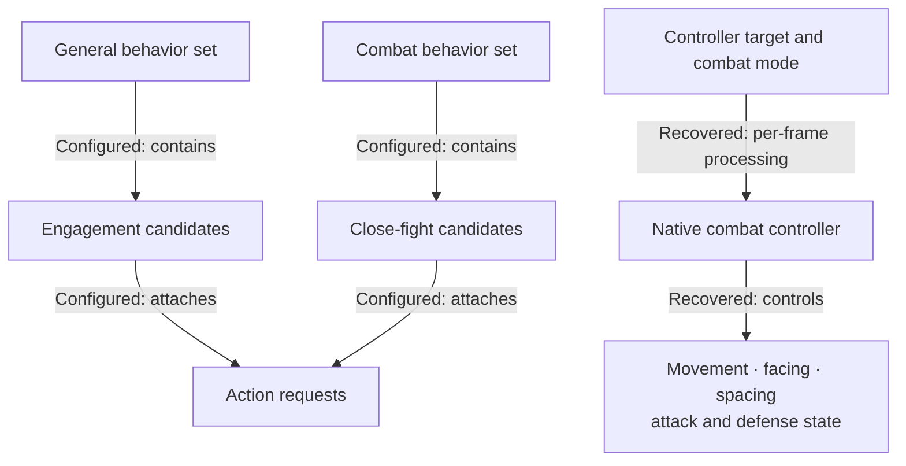

# How melee bots work

A Chivalry 2 melee bot is not driven by one monolithic “fight” script. It combines a decision
layer that describes possible behaviors with a combat-controller layer that owns the immediate
fight: target, movement, spacing, facing, and attack state.

This separation explains several otherwise confusing observations:

- A bot can have a full inventory of combat behaviors without evidence that its decision maker is
  currently selecting any of them.
- A bot can approach, circle, face an opponent, and attack through the combat controller even when
  its decision-maker activity is not established.
- Changing a behavior configuration and changing a movement setting are different operations with
  different effects.

## The layers and the untraced handoff

Plaintext: general and combat sets contain authored behavior candidates with action requests. If
selected, an action can write a controller request; the diagram intentionally does not claim that
selection happened in an ordinary match. Separately, recovered native code uses combat target and
mode state to drive movement and combat. The observed bot cache and visible fight do not connect
these two layers into one traced decision-to-action path.

In practical terms:

1. The bot has a controller, a pawn, and world information such as nearby characters and combat
   state.
2. General and combat decision-making surfaces can hold behavior candidates.
3. A behavior combines a weight, considerations, an action, and sometimes a target generator.
4. If a behavior is selected, its action requests something from the controller.
5. The combat controller carries out combat movement and combat-state work while its combat gate is
   satisfied.

## Controller and pawn

The **pawn** is the visible character: it moves, animates, receives hits, and has a weapon and
combat state. The **controller** is the AI-side object that holds decision-making components and
combat-control state.

The controller’s important combat responsibilities include:

- remembering the current **combat target**;
- tracking whether it is out of combat, entering combat, or fighting;
- choosing an intended spacing mode;
- producing movement and target-facing behavior;
- holding or releasing requests such as block;
- retaining attack-order information while an attack is being pursued.

The controller is therefore the practical connection between “a behavior wants to attack” and “the
character enters windup, releases a swing, recovers, or moves toward an opponent.”

## Two decision-making surfaces

Normal melee controllers expose two related decision-making surfaces:

| Surface | Main purpose | Typical content |
|---|---|---|
| **General** | Broader world behavior and target engagement. | Enter combat, respond to damage, revive, move around objectives, escape a local danger. |
| **Combat** | Choices while a combat target already exists. | Slash, overhead/stab, feint, block, wait, shove, and event-specific reactions. |

**Configured/Recovered:** a general engagement behavior has a target generator and an action that
can validate an enemy and request controller engagement. The combat set contains close-fight
candidates configured around the existing controller-side combat target. **Unknown:** whether that
general behavior initiated a particular ordinary-match fight.

!!! note "Combat behaviors do not normally generate their own targets"
    The documented normal melee combat behaviors use the controller’s current combat target. Their
    target-generator field is empty. General behaviors, by contrast, can use generators that look
    for suitable characters or locations.

## Behavior sets are inventories, not scripts

A **behavior set** is a named group of behavior classes. The normal melee combat set contains
behaviors for common attacks, defense, waiting, feinting, and shoving.

That tells us the bot has those options available. It does not mean the bot must run them in a fixed
sequence such as “slash, block, wait, shove.” Each behavior has its own conditions and relative
weight.

At runtime, a decision maker can materialize behavior objects from a behavior set. Those objects
retain their own action settings, considerations, timers, and recent-action bookkeeping.

!!! warning "Cached does not mean active"
    A behavior object can exist on a bot while the decision layer is inactive or while another
    layer is providing the visible combat behavior. Do not use a cache inventory as a fight replay.

## From behavior to action request

A behavior describes a candidate activity:

| Part | Question it answers |
|---|---|
| **Weight** | How strong is this candidate before its situation-specific conditions? |
| **Considerations** | Does distance, cooldown, nearby allies, a recent block, or another signal favor it now? |
| **Action** | What should happen if this candidate is selected? |
| **Target generator** | Which targets should the candidate consider, if it needs to generate targets? |

For a normal combat attack, the action can request an allowed attack type and an attack-oriented
spacing intent. For a block, the action can request holding parry for a configured duration. For a
wait, the action can request a spacing intent and delay completion.

Read [behavior and movement formulas](formulas.md) for the known score-shaping math. The important
practical point is that a high behavior weight alone is not a guaranteed action: other
considerations, active actions, and decision rules still matter.

## From action request to visible fighting

An action can request combat work, but the native controller determines whether it can carry that
work out in the current situation. In broad terms, combat movement requires a valid combat target
and an active combat mode. With that gate satisfied, the controller can:

- close distance or maintain a requested range;
- face the combat target;
- make lateral movement shaped by its runtime combat-movement settings;
- pursue an attack order;
- hold or release defensive input;
- react to the pawn’s changing combat state.

The visible state machine is familiar to players: idle, holding, windup, release, recovery, and
related interruption or hit states. An action can use those state changes to know whether it has
finished.

## A typical engagement, with evidence boundaries

This is the supported conceptual path, not a claim that every ordinary-match encounter has been
recorded from start to finish:

1. A general behavior may identify an enemy candidate.
2. Its engagement action can ask the combat controller to engage that actor.
3. The controller records the combat target, enters an engagement state, and begins combat movement.
4. Once close enough, the controller can enter active combat.
5. Combat behaviors are the configured candidates for attack, block, wait, feint, shove, and
   event-associated reactions.
6. A selected combat action can request an attack or defensive control.
7. The controller and pawn carry that request through combat movement and combat-state transitions.

**Observed:** native combat movement and attacks can occur while decision-maker activity is not
established.  
**Configured:** normal melee behavior sets contain the candidates described above.  
**Unknown:** a complete ordinary-match trace that attributes each visible action to a specific
decision winner.

## What this controls, does not control, and leaves unknown

| Category | Summary |
|---|---|
| **Controls** | The controller owns immediate combat target, combat mode, spacing intent, movement, facing, attack state, and defensive requests. |
| **Does not control by itself** | Having a behavior set or cached behavior does not itself make the behavior run. |
| **Unknown** | The full ordinary-match causal chain from perception through every decision winner to every visible action has not been established. |

Next: [Decision-making and scoring](decision-making.md) explains how a behavior becomes more or
less attractive, while [Movement and spacing](movement-and-spacing.md) explains the controller's
combat-target-dependent movement.
