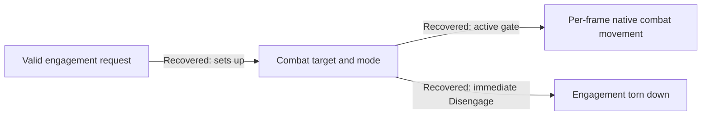
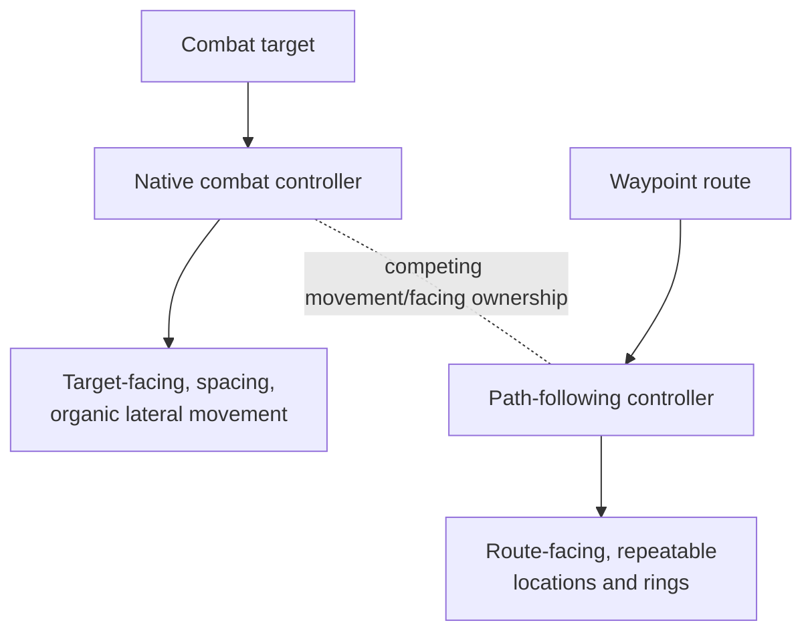

# Movement, spacing, facing, and combat state

The combat controller, not a behavior set alone, makes a melee bot physically approach, face, orbit,
and fight an opponent. A behavior or action can request an intent such as “attack at my range” or
“wait at standoff range,” but the controller turns that intent into movement only while it has a
valid combat target and is in a combat mode.

## Entering and leaving combat

**Recovered:** a valid engagement request sets up controller-side target and mode state.
When the combat gate is active, native per-frame processing can approach, face, and adjust
position around the target. An immediate disengagement tears down that state.

This describes a controller capability, **not** an observed General UtilityAI behavior winning
and causing engagement in every ordinary fight.

The controller-side target is the anchor for normal melee combat behavior. The documented normal
combat behaviors do not independently search for targets.



Plaintext: a valid controller engagement request sets up a target and combat mode. When the
combat target is present and the mode is not OutOfCombat, recovered per-frame code can handle
combat movement. An immediate Disengage clears that engagement. The diagram does not establish
the ordinary-match caller of Engage or every internal mode transition.

## Spacing intents

Combat actions can ask for a named distance intent:

| Intent | Human meaning |
|---|---|
| **Facehug** | Move into very close pressure range. |
| **My attack range** | Prefer the bot’s own usable attack range. |
| **Outside enemy attack range** | Prefer distance outside the opponent’s usable range. |
| **Standoff range** | Maintain a more neutral separation. |

When no active attack order takes precedence, the controller selects a requested distance from the
intent. An active attack order can instead supply an attack distance.

The supported conceptual model is:

\[
  d_{\text{goal}} = d_{\text{selected intent}} \times \nu(t)
\]

Here \(d_{\text{selected intent}}\) is the chosen range, and \(\nu(t)\) is a runtime
engagement-variation factor. The controller then moves in response to the difference between the
current and desired range.

Plaintext:

```text
goal distance = selected spacing distance × runtime variation
```

The variation is intentionally left symbolic. It is known to affect runtime motion, but it is not a
supported public tuning control with a documented stable equation.

## A verified spacing control

The facehug range is a verified controller-side spacing control in controlled movement-only tests.
Changing it changed the realized approach distance while the target was stationary and offensive
behavior candidates were suppressed.

That is an important distinction:

- **Facehug range:** demonstrated effect on approach distance in the controlled setup.
- **Combat-target desired-distance field:** persisted when written in testing, but did not provide
  a clear realized stand-off-distance effect by itself.
- **Named desired-distance/strafe requests:** can be reset by active behavior/action paths rather
  than remain a durable manual movement command.

## Facing and lateral movement

While the controller is in combat, it can face the combat target closely while moving around it.
Controlled observations show substantial lateral motion with target-facing yaw, including changes
of orbit direction.

However, the named “desired strafing” request is **not** a deterministic circle-strafe API. The
documented combat-movement implementation does not use that request as the direct source of lateral
movement. Instead, private runtime variation settings influence strafe pattern, timing, and
strength.

!!! warning "Do not promise deterministic native circling"
    A bot can visibly orbit and shuffle around a target, but the supported public controller
    surface does not expose a stable, repeatable direction/strength control for that motion.

## Native combat movement versus waypoint movement

There are two useful but distinct movement systems:

| System | Good for | Main limitation |
|---|---|---|
| **Native combat movement** | Target-facing approach, close combat range control, and organic lateral movement while engaged. | Lateral variance is not publicly deterministic. |
| **Waypoint/path-following movement** | Repeatable routes, exact rings, and scripted circles through chosen locations. | The pawn tends to face the waypoint/movement heading rather than continuously face the opponent. |

Do not combine both systems as though they were one steering algorithm. A combat controller and a
path-following controller can compete for movement and facing ownership.



Plaintext: native combat movement owns target-facing engagement and variable combat motion.
Waypoint movement owns a planned route. Use one as the primary owner when repeatability matters;
running both as if they were one steering system can make movement and facing fight each other.

## What has been effective, unreliable, or unavailable

| Status | Control or observation | Interpretation |
|---|---|---|
| **Works in controlled tests** | Engage a valid target and use the combat controller’s native movement gate. | Enables native approach, facing, and combat movement without proving a UtilityAI winner. |
| **Works in controlled tests** | Change the facehug range. | Changes close-range approach distance under the documented test conditions. |
| **Works for scripted routes** | Use waypoint movement around a ring of locations. | Gives repeatable circles, but it is waypoint steering rather than native combat strafe. |
| **Unreliable as a manual command** | Write desired distance or desired strafe mode while behaviors are active. | Active action paths can replace those values. |
| **Not a supported public tuning control** | Runtime strafe pattern, direction, rate, and strength. | They affect motion but are not exposed as a stable public interface. |
| **Unknown** | A deterministic native combat circle with independently chosen direction and strength. | Requires a supported control surface or additional research. |

## What this controls, does not control, and leaves unknown

| Category | Summary |
|---|---|
| **Controls** | Combat target, combat mode, native approach, supported range selection, target-facing, attack-state movement, and defensive movement context. |
| **Does not control by itself** | A desired-strafe request does not command a stable clockwise/counter-clockwise orbit; a desired-distance write is not necessarily the active range goal. |
| **Unknown** | A public deterministic control for native strafe variance and a complete ordinary-match explanation for every movement adjustment. |
