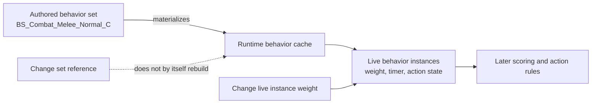

# Personality, difficulty, and safe tuning

Bot difficulty is not one slider. It is expressed through a combination of behavior-set choices,
event-response choices, personality values, controller movement variation, and the behavior objects
already materialized on a bot.

The most useful tuning rule is simple:

> Change the layer that actually owns the behavior you want to change, and verify whether the bot
> has already cached its runtime objects.

## Normal and simplified combat inventories

The documented normal melee combat inventory is `BS_Combat_Melee_Normal_C`:

| Behavior | What it adds |
|---|---|
| `BC_Slash_C` | Standard Slash option. |
| `BC_OverheadStab_C` | Overhead or Stab option. |
| `BC_FeintAttack_C` | Feint-capable attack option. |
| `BC_Block_C` | Brief defensive parry option. |
| `BC_Wait_C` | Low-score wait and spacing option. |
| `BC_Shove_C` | Shove pressure option. |

The documented simplified variant, `BS_Combat_Melee_Dumb_C`, removes the feint behavior. Event
sets also have simpler variants; for example, a simplified incoming-attack set can omit Jab and a
simplified parry-success set can omit the feint follow-up.

This is a useful **configured capability** difference. It is not, by itself, a complete measured
difficulty curve.

## What was observed on default spawns

Documented default spawned bots used the normal combat set and had all six normal combat behaviors,
including `BC_FeintAttack_C`, available in their combat behavior cache.

That result corrects an earlier expectation that a default spawn might use the simplified set.
However, the exact general-purpose runtime selector that chooses and reapplies personality rows is
not established as a public, general per-spawn control.

| Question | Supported answer |
|---|---|
| Does a documented default spawn have normal combat behaviors? | **Observed:** yes, including the feint behavior. |
| Can the authored data contain simplified and advanced variants? | **Configured:** yes. |
| Is there a universal public call to choose any personality row for each newly spawned bot? | **Unknown:** not established. |
| Does changing a shared controller default automatically change an existing spawn? | **Observed:** no reliable propagation was demonstrated. |

## Behavior sets versus runtime behavior caches

Behavior sets are class-level inventories. A decision maker can create runtime behavior objects from
them, and those objects retain their own weight, action, consideration, and timer state.

Plaintext: the authored set can be used to create cached runtime objects, which in turn contain
the live behavior instances. Changing a set reference changes that reference; it does not itself
rebuild the existing cache. Changing an instance's weight reaches that instance, but does not
guarantee that it wins or becomes visible.

This produces an important cache boundary:

| Change | What it changes reliably | What it does not guarantee |
|---|---|---|
| Change a behavior-set reference | The configured set reference. | Rebuilding an already-existing behavior cache. |
| Change a live behavior instance’s weight | That instance’s relative scoring bias. | A selected winner, active decision loop, or a complete ordinary-match result. |
| Change an event-set reference | The configured reaction-set reference. | Replacing a cached event behavior array immediately. |
| Change a shared class default | The shared default object. | Propagation into existing separately created instances. |

!!! warning "Do not assume a set write rebuilds a bot"
    A live bot can retain behavior objects that were created before a behavior-set reference changed.
    Treat set replacement and runtime-cache rebuilding as separate operations.

## A bounded movement-only control technique

For controlled research, attack pressure can be reduced by changing the live weights of the
offensive normal-combat behavior instances:

- `BC_OverheadStab_C`
- `BC_Shove_C`
- `BC_FeintAttack_C`
- `BC_Slash_C`

This has been used to isolate native movement and spacing behavior while retaining the controller’s
combat target and combat-movement gate.

It is a **research control**, not a general difficulty recipe:

- remaining behaviors can still affect the bot unless they are also accounted for;
- it does not prove the decision layer is active;
- it should not be confused with replacing the authored behavior set;
- it should not be used to enable UtilityAI on a sparring bot.

## Personality and variance

Personality configuration can supply behavior-set and event-set choices and can influence combat
variation. Some controller-side movement variation is initialized during possession and affects
engagement distance and lateral movement.

The important practical limit is that the documented runtime movement variation is not exposed as a
stable public tuning interface. A behavior or controller intent can request a spacing mode, but it
does not provide a reliable public knob for exact lateral direction, rate, or strength.

See [movement and spacing](movement-and-spacing.md) for the supported movement controls and their
limits.

## Safe tuning checklist

Before calling a result a successful tuning change:

1. Identify the owner: behavior instance, behavior-set reference, event-set reference, controller
   range, or movement path.
2. Read back the changed value from the exact live object.
3. Check whether the bot already has cached behavior objects.
4. Measure the intended visible outcome separately from the value write.
5. Restore or destroy only the test actor used for the experiment.

## What this controls, does not control, and leaves unknown

| Category | Summary |
|---|---|
| **Controls** | Authored normal/simplified behavior inventories, live behavior-instance weights, configured event-set references, and supported controller range settings. |
| **Does not control by itself** | A set reference does not guarantee cache rebuilding; a weight change does not guarantee a visible winner; a spacing request does not deterministically set strafe direction. |
| **Unknown** | A universal personality-row selector/reapplication method and a complete public deterministic control for combat-movement variance. |
