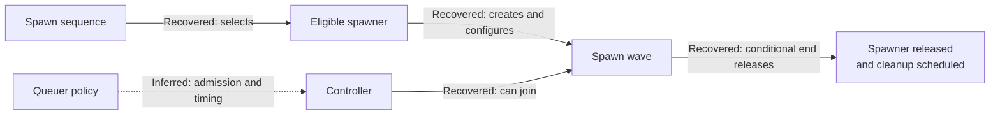

# Spawn System Overview

> [!summary] The smallest correct model — **Inferred**
> A **spawn sequence** orders waves across placed **spawners**. A spawner creates a **spawn wave**,
> the wave collects joining **controllers**, and a **queuer** can govern who is admitted and when.
> Authored spawner Blueprints add the camera, HUD, and run-in presentation around that core.
> The exact native path that admits a player in an ordinary respawn is not fully established.

Plaintext: recovered code shows a sequence selecting a spawner, the spawner creating a wave, and a
controller being able to join that wave. A queuer can be the admission and timing policy, but its
mode ownership and live dispatch are not fully traced. When its recovered end conditions apply, a wave
releases its spawner and schedules cleanup. The complete ownership model is **Inferred**.

| Layer | Short version |
|---|---|
| **Sequence** | Orders waves, tracks active waves, and limits concurrency. |
| **Spawner** | Creates and configures a wave at a placed location. |
| **Wave** | Holds joining controllers, state, and timing; releases its spawner when it ends. |
| **Queuer** | A separate policy for admission and respawn timing; its ownership by a mode is **Inferred** from where it appears. |
| **Authored spawner** | Adds presentation and movement behavior on top of the native spawner. |

For the full guide, start at the [spawning guide landing page](README.md).

??? "Sample and interpretation cautions"

    > [!info] A separate observed sequence
    > In the TDM Wardenglade / InProgress sample, a player was without a pawn, then a faction wave had
    > one joined controller, then a new pawn was possessed. Those are time-ordered observations, not an
    > attributed controller-to-pawn call chain: the function that wrote the membership and created the
    > pawn remains **Unknown** for that sample.

    > [!tip] A placed spawner is an inventory entry
    > A spawner type being present in authored assets tells us it exists and what it can do. It does not
    > say which spawner a live spawn selected.

    > [!warning] A wave object is not a membership log
    > An empty wave in one snapshot can later hold a controller. A single sample does not establish what
    > admitted that controller or which callable performed the spawn.

    > [!info] Missing calls at one entry point are sample-bounded
    > In the TDM Wardenglade / InProgress respawn sample, several spawn-related callables were not
    > dispatched while a control callable did fire. That is a useful negative result for those entry
    > points, not a complete model of every respawn path.

## Where to go next

| Question | Page |
|---|---|
| How do the layers connect? | [How spawning works](how-spawning-works.md) |
| What does each component own? | [Components](components.md) |
| How do the queue policies differ? | [Queues and timing](queues-and-timing.md) |
| What differs between FFA, TDM, LTS, and TO? | [Game modes](game-modes.md) |
| How certain is each claim? | [Evidence and limitations](spawning-evidence-and-limitations.md) |

## Related

- [[Spawner]] — the authored spawner-type index.
- [Chivalry 2 Systems Overview](../Chivalry%202%20Systems%20Overview.md)
