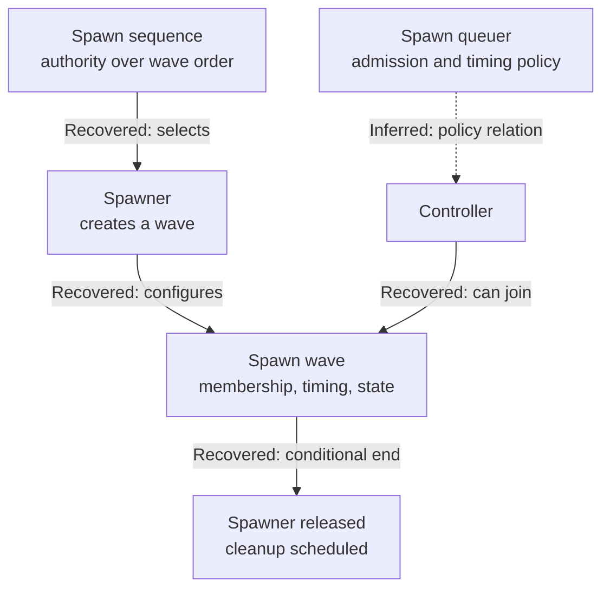

# How spawning works

This page connects the spawning layers and marks where each handoff is established. It describes
ownership and lifecycle, not a complete call trace.

## The ownership chain



Plaintext: a sequence selects a spawner, which creates a wave. A queuer can supply controllers to
that wave under its own timing policy. A controller can join the wave, and the wave's recovered end
path releases the spawner when its conditions apply. This composite ownership chain is **Inferred**;
the edge labels show which individual operations are Recovered and which relation is Inferred.

> [!info] Observed sequence, not a traced edge
> In the TDM Wardenglade / InProgress sample, a pawnless player was followed by a faction wave with
> one joined controller, then by possession of a new pawn. The native writer of that membership and
> the pawn-creation path were not attributed in that sample, so the diagram does not draw them as a
> causal handoff.

## 1. The sequence selects a spawner

**Recovered.** A sequence checks that the game mode permits spawning, that it is active, that it has
spawners available, and that it is not already at its simultaneous-wave limit. It then chooses an
eligible, unlocked spawner, prefers spawners that have been pushed into the candidate set, applies
its timing and player-count overrides, starts the spawner, records the resulting wave, and can
continue while more waves are permitted.

**Unknown.** Every selection tie-breaker, the activation/deactivation path in each mode, and whether
a given live spawn used a sequence at all.

## 2. The spawner creates a wave

**Recovered.** A spawner refuses to start after the match or map is leaving and rejects an
incompatible special spawn. Otherwise it spawns a wave, associates itself with that wave, resolves
faction precedence, and applies merged parameter overrides. The wave is the spawner's active
spawn job, not just a list of positions.

**Unknown.** Reservation, location scoring, and the exact meaning of the virtual callback a wave
invokes on its spawner when it finishes.

## 3. The wave collects controllers and ends

**Recovered.** A wave exposes a joinable surface, tracks joined and previously joined controllers,
replicates its state and a joined-player-state list, and holds timing and capacity settings. Its
recovered join body adds a controller to the joined set, records it in controller history, removes it
from the rejected set, appends that controller's player state to the replicated list, and assigns the
wave as that controller's next spawn wave. Duplicate joins do not insert twice.

**Recovered.** The recovered end body moves an authority wave to the ending state when control is
not restricted, clears the spawner's pending lock and pending-wave pointer, invokes a spawner
callback, broadcasts that the wave finished, and schedules cleanup.

**Unknown.** The full state transition table, replication timing, refusal and leave paths, and what
clients do with the replicated membership.

??? "Wave lifecycle and live-admission boundary"

    ```mermaid
    stateDiagram-v2
      NotStarted --> Spawning: Recovered StartSpawning sets state on authority
      Spawning --> Ending: Recovered End on authority when control is unrestricted
    ```

    Plaintext: recovered `StartSpawning` code sets an authority wave to spawning, but what calls that
    method in a particular live path remains Unknown. Recovered `End` code can move an authority wave
    to ending when control is not restricted. Other transitions, their triggers, and client-side timing
    remain Unknown.

    > [!warning] A recovered callable is not the live admission path
    > Recovered code shows that `JoinSpawn` writes wave membership, and that one queuer implementation
    > can invoke it through native virtual dispatch. In the TDM Wardenglade / InProgress respawn
    > sample, the reflected spawn callables did not dispatch while a control callable did fire. That
    > does not attribute the observed membership write to the recovered virtual path; the live writer
    > remains **Unknown**.

## 4. The queuer is a separate policy layer

**Recovered.** Queuer variants decide admission and respawn timing: one records a per-controller
accumulated delay, another uses a shared group window and diverts late entrants into a solo queue,
and another records wave-timing metadata when admitting a controller. These are policies, not
spawners; they do not create the wave themselves.

**Recovered.** One queuer implementation filters live waves for eligible player handling, world,
faction, and joinability; it compares the candidates with their `GetTimeLeft` result, keeps the
lowest result, and invokes that wave's `JoinSpawn` through native virtual dispatch. `JoinSpawn`
records controller membership and the replicated player-state list. This is an implementation path,
not a recorded live call.

**Observed.** In TDM Courtyard / InProgress and TDM Wardenglade / InProgress samples, a queuer
instance was present under the mode object, including during player respawn, while its bot-waiting
array stayed empty. In a TDM Courtyard / InProgress sample, a controlled bot addition filled that
array and produced pawns while sampled wave membership stayed zero. An LTS Courtyard /
WaitingToStart sample also had a queuer but no waves.

**Inferred.** Its placement under the mode object suggests it is that mode's admission/timing
policy. Mode creation was not observed.

**Unknown.** Whether the sampled respawn used the recovered queuer-to-join path, which queuer
variant a given mode actually uses for players, the meaning or units of the `GetTimeLeft` result, and
how solo entries are promoted or cancelled.

## 5. The observable player handoff

**Observed.** In the TDM Wardenglade / InProgress sample, a controlled player-death test left the
player without a pawn while a faction wave gained one joined controller. A new pawn was then
possessed. The wave belonged to an authored run-in spawner, and the queuer's bot-waiting array was
empty throughout.

??? "Worked example: observed respawn and recovered path"

    | Evidence | What it establishes | What it does **not** establish |
    |---|---|---|
    | **Observed — TDM Wardenglade / InProgress** | A player was without a pawn; a faction wave then had one joined controller; a new pawn was later possessed. | Which function wrote membership, created the pawn, or selected that wave. |
    | **Recovered — `NewSpawnSystemQueuer` request path** | The queuer can filter eligible waves, compare their `GetTimeLeft` results, choose the lowest-result wave, and request `JoinSpawn` through native virtual dispatch. | That this request path ran in the Wardenglade sample, or that its timing result predicts pawn arrival. |
    | **Recovered — `JoinSpawn`** | That method records controller membership/history and a replicated joined-player-state entry. | That it was the observed writer, or that its bookkeeping by itself creates a pawn. |

    Plaintext: the live sample supplies an order of visible changes. The recovered code supplies a
    possible admission path and its bookkeeping. They describe compatible facts, but available evidence
    does not connect them into one traced call chain.

**Unknown.** The native function that wrote the membership, where the pawn was created, and when
player control was released.

??? "Reading boundaries"

    | Established | Not established |
    |---|---|
    | Sequence eligibility checks and spawner selection | Activation and selection in every mode |
    | Spawner wave creation and configuration | Location scoring and reservations |
    | Wave join/end bookkeeping | Full state machine and replication timing |
    | Distinct queue admission policies | Due-entry dispatch and mode ownership |
    | One observed death-to-pawn handoff | The native path that produced it |

For the per-component inventory, see [Components](components.md); for what the evidence does not
support, see [Evidence and limitations](spawning-evidence-and-limitations.md).
