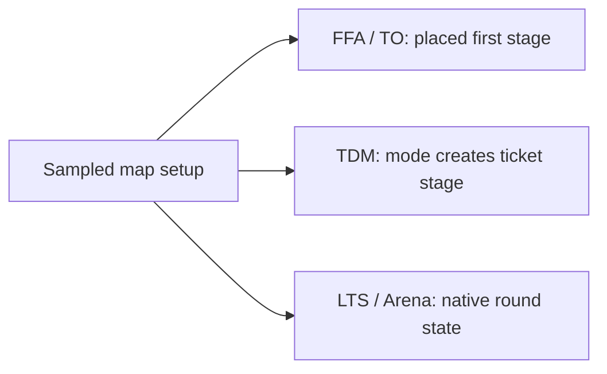

# Stages and rounds TL;DR

Chivalry 2 does not use one identical lifecycle for every mode.

Plaintext: sampled FFA and TO maps supplied placed first stages, the sampled
TDM mode created a ticket stage, and the sampled LTS and Arena matches used
native round state. The diagram describes observed ownership in those maps,
not a recipe or a universal rule for all maps.

- **FFA and TO:** sampled maps used placed stage actors. TO's sampled map had a
  chain of scored stages; FFA used a placed timeout stage.
- **TDM:** the sampled mode created a ticket stage from its settings instead of
  using a placed ticket-stage actor.
- **LTS and Arena:** sampled matches exposed native round, life, and victory
  state rather than a stage-interface actor.

What ends a match also depends on the implementation. A stage's timer, score
threshold, or terminal flag can be relevant, but a generic stage-time query may
read zero while the active component timer still counts down. Read the mode and
stage-specific rules rather than assuming a universal clock.

> [!note]
> Several terminal paths were measured with controlled score, ticket, or method
> triggers; timer expiry was sometimes accelerated. They show what a sampled
> path can do, not a guarantee about ordinary player-driven matches.

The most important exception is FFA: in the sampled controlled score-limit
capture, the match entered post-match while its timeout stage remained current.
Do not assume that every completed stage installs a visible successor as the
current stage.

For the detailed boundaries and remaining questions, start with
[Stage and round overview](stages-overview.md), inspect
[map authoring surfaces](stages-map-authoring.md) if you are building a map,
and finish with
[Evidence, limits, and terminology](stages-evidence-and-limitations.md).
