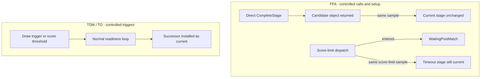

# Endings and successor handoff

A terminal condition and a visible successor are separate questions. A stage
can return an object, make itself ready, or end a match without all modes
installing the same kind of current successor.

## Which paths actually installed a successor?

Plaintext: a direct FFA completion returned a candidate without installing it;
in a separate controlled FFA score-limit match, post-match began with the
timeout stage still current. In sampled TDM draw and TO score tests, controlled
triggers reached the normal readiness loop and a successor became current.
These are distinct experiments, not one universal path or evidence that the
same gameplay event invokes them in an ordinary match.

The table also includes accelerated timer expiry and a bot-driven Arena
round, which are different kinds of observation:

| Mode | Trigger examined | What was observed | Boundary |
|---|---|---|---|
| FFA | Accelerated component expiry | The timeout path completed the sampled match and reached post-match. | This establishes component expiry under accelerated game time, not real-time pacing. |
| FFA | Direct completion with written kill totals | Tie and unique-leader branches returned candidate sudden-death or victory objects. | A returned object did not become current in this direct-call test. |
| FFA | Controlled score-limit setup | The award path fired and the match reached post-match while the timeout stage remained current. | Do not generalize this captured path to every FFA map or ordinary player kill. |
| TDM | Direct draw trigger | The draw flag made the stage ready; after a linger, a draw stage became current and post-match began. | The natural caller of draw is unknown. |
| TDM | Controlled ticket exhaustion | Terminal flags made the stage ready and ended the sampled match. | Ticket values were written for the test. |
| TO | Controlled score thresholds | The normal readiness loop installed each successor through the fifth stage, then attacker victory. | Score sources were written directly; ordinary objectives are unknown. |
| TO | Accelerated stage-1 expiry | A defender victory stage became current. | Later-stage timeout behavior is unknown. |
| Arena | Ordinary bot-driven 3v3 deaths | Life changes, a round-win broadcast, post-match, and podium were observed. | The native victory caller was not directly observed. |
| Arena | Direct round-victory call | The call ended a one-round test, or reached intermission and round 2 after the round count was changed for the test. | This is controlled callable behavior, not ordinary kill dispatch. |

## The FFA exception

The sampled TDM draw and TO score paths installed a new current stage through
their readiness loop. FFA did not provide a universal counterpart:

- Direct FFA completion returned a candidate object without changing the
  current stage.
- The captured controlled FFA score-limit path entered post-match while the
  timeout stage remained current.

The recovered native base of the FFA award method is a virtual forwarder. Its
override and the selected victor's behavior remain **Unknown**. The safe
conclusion is not “FFA installs no successor,” but “the sampled FFA paths did
not show a current victory-stage installation.”

## Reading controlled results

Controlled observations are useful because they show how a known terminal
surface responds. They do not establish what ordinary play invokes:

- Direct score, ticket, or round-victory changes do not identify the normal
  gameplay event that produces them.
- Accelerated expiry shows that an active timer can reach its terminal state;
  it does not measure normal pacing.
- A bot-driven round establishes its observed team-state sequence, not a
  human-player combat or respawn rule.

See [Evidence, limits, and terminology](stages-evidence-and-limitations.md)
for the remaining Unknowns.
