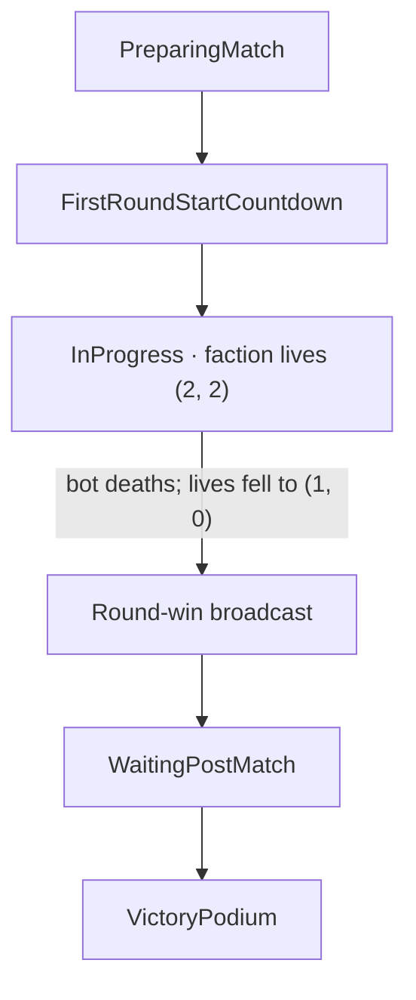

# Sampled native-round modes: LTS and Arena

The sampled LTS and Arena matches exposed native round configuration on
[[ref:AArenaGameMode|Arena-derived game modes]] and live team-life state in
the game state. This is different from the active stage actors
observed in the sampled FFA, TDM, and TO matches.
For the settings classes and fields to inspect when authoring a map, see
[Map authoring surfaces](stages-map-authoring.md).

## Last Team Standing

### Map supplies

**Configured:** the sampled map selected native LTS settings. Its level also
contained authored stage-start-related surfaces, but their dispatch was not
established.

### Mode owns

**Observed:** the match used native round fields such as round number, lives,
and round delays. No stage-interface actor was found in the bounded sample.

### Observed

The sampled match advanced through preparation and first-round countdown into
play after an additional participant joined. That does not establish a
required team size for a custom LTS map.

??? "Why the startup sample is limited"

    The initial one-player setup did not progress until a bot was added. The
    intervention is a test condition, not an authored minimum-player rule or
    evidence about which round events are dispatched.

### Unknown

The ordinary round-end owner and life writer, LTS scored-stage instantiation,
and level round-event dispatch remain unknown.

## Arena

### Map supplies

**Configured:** the sampled Arena map selected native Arena settings and had
three initial spawners per faction. It is therefore 3v3-shaped; a generic
maximum-player setting is not a 1v1 rule.

### Mode owns

**Observed:** native round number, per-faction lives, and round-victory state
were active. **Configured:** the map's round time limit was zero; this
bot-driven round had no round countdown to observe.

### Observed

In an ordinary bot-driven 3v3 round, the per-faction life pool fell with
deaths, a round-win broadcast occurred, and the match moved through post-match
to the victory podium. The local player had no spawned pawn, so this supports
team-life and victory-state observations, not human combat or respawn claims.

### Observed Arena round sequence

This is a sequence of **observed bot-match states**, not a recovered native
call chain:

Plaintext: in the sampled Arena 3v3 bot match, preparation led to a first-round
countdown and play; the faction life pools fell from (2, 2) to (1, 0), then a
round-win broadcast was recorded before post-match and the victory podium.
The broadcaster's ordinary native caller and the exact life writer were **not**
identified. The separate direct victory-call experiment below is not an arrow
in this observed sequence.

??? "Controlled comparison: direct round-victory call"

    A separate direct
    [[ref:ArenaGameMode::AwardRoundVictoryAndEndRound|round-victory call]]
    ended a single-round configuration. When the round count was
    changed for the test, the direct call instead entered intermission and
    began round 2. This is evidence about the controlled callable path, not
    an observed five-round map configuration or ordinary kill dispatch.

### Unknown

The exact native writer and ordinary caller of the victory path, faction
selection in all branches, and level round-event dispatch remain unknown. The
ordinary bot run did not directly confirm the round-victory method hook.

See [Endings and handoff](stages-endings-and-handoff.md) for why direct calls
and ordinary state transitions remain separate evidence.
