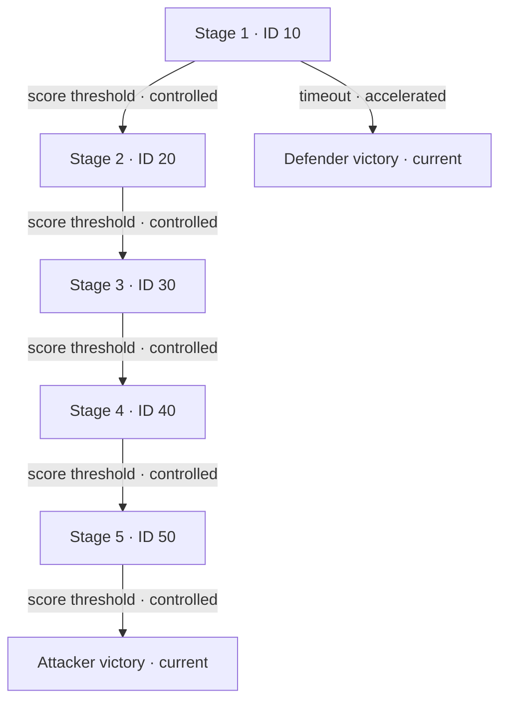

# Sampled staged modes: FFA, TDM, and TO

These panels separate what the sampled map supplied from what the mode created
or used at runtime. They do not turn one map into a rule for every map.
For specific World Settings, hooks, and TO initialization values, see
[Map authoring surfaces](stages-map-authoring.md).

## Free-for-All

### Map supplies

**Configured:** the sampled FFA map selected its FFA game mode and settings,
and its level provided a placed timeout stage through the first-stage surface.

### Mode creates or uses

**Observed:** that placed timeout stage was active in the sampled match.
**Decoded:** the mode also has a fallback path that can create a timeout stage
when a suitable level result is unavailable. No sampled map was observed using
that fallback.

### Observed

- The placed stage ran with a component countdown of about fifteen minutes.
- Accelerated component expiry completed the sampled match.
- A controlled score-limit setup dispatched the FFA award path and reached
  post-match while the timeout stage remained current.

### Unknown

An ordinary player-driven score-limit kill, the selected victor, the virtual
award override, and natural tied-score sudden-death dispatch remain unknown.
The score-limit path is separate from timeout-stage readiness; see
[Timers and readiness](stages-timers-and-readiness.md).

## Team Deathmatch

### Map supplies

**Configured:** the sampled map selected TDM settings and a level
stage-start surface. It did not contain a placed ticket-stage actor.

### Mode creates or uses

**Observed:** the mode created and used a dynamic ticket stage with a
600-second component timer and 75 tickets per tracked faction in the sample.

### Observed

- Component expiry completed the sampled match under accelerated game time.
- A bot-match kill handler coincided with single-ticket decrements, without
  direct ticket edits.
- Controlled ticket exhaustion and a controlled draw trigger made terminal
  readiness paths available.

### Unknown

The exact death pairing and faction-loss rule for the observed ticket changes
are not established; the capture included additional attempted death triggers
whose contribution could not be isolated. The natural caller of the draw path
and ordinary defeat/draw selection also remain unknown.

## Team Objective

### Map supplies

**Configured:** the sampled TO map contained five placed scored stages and
configured successor and timeout outcomes. A transition stage was also present
as the previous stage when the first scored stage was current.

### Mode creates or uses

**Observed:** the staged mode made the placed scored stages current in sequence.
The presence of a transition instance does not prove which configured warmup
path created it.

### Observed

With each current stage set to its configured score threshold, the normal
readiness path advanced through stages 1–5 and reached an attacker victory
stage. An accelerated timeout of stage 1 installed a defender victory stage.

### Bridgetown stage flow

The arrows below show **two different kinds of evidence** on this one map.
The solid score route was **Observed with controlled score writes**; the
stage-1 timeout route was **Observed with accelerated expiry**. The level
configures timeout destinations for stages 2–5, but those outcomes were not
observed and are not drawn as tested transitions.

Plaintext: in a controlled Bridgetown run, setting each current stage's score
to its configured maximum moved the current stage from 1 to 2, 3, 4, 5 and
then attacker victory. Separately, accelerating stage 1's timer expiry
installed defender victory. The arrows do not identify ordinary objective
score sources or establish later-stage timeout behavior. The
[authoring table](stages-map-authoring.md#how-the-sampled-staged-maps-provide-a-first-stage)
lists all configured score and timeout destinations.

### Unknown

The ordinary objective events that supply score, draw usage, timeout behavior
for stages 2–5, and cross-map behavior remain unknown. The controlled score
chain establishes successor handoff, not ordinary objective progression.

For terminal-path detail, including why FFA is different from the sampled TDM
and TO handoffs, see [Endings and handoff](stages-endings-and-handoff.md).
